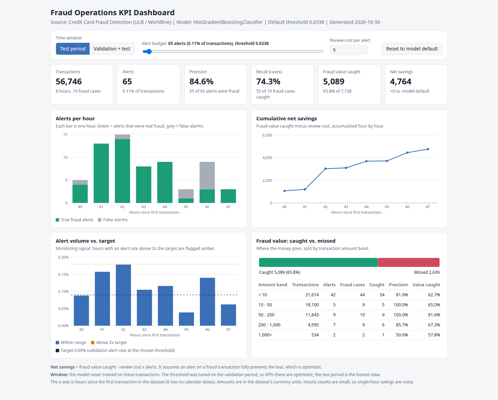

# Fraud Operations KPI Dashboard

> Monitoring dashboard for a card-fraud model: alert volume, precision, fraud value caught, net savings and volume-spike detection, with an interactive alert-budget slider. SQL + Python + a standalone HTML dashboard.

**Live demo:** `https://andikapratamazaid.github.io/fraud-ops-kpi-dashboard/dashboard/` *(after you enable GitHub Pages, see below)*
**Companion project:** [Fraud Detection in Online Card Transactions](https://github.com/andikapratamazaid/fraud-detection-card-transactions) (the model this dashboard monitors)



## Business Problem
A fraud model is only useful if the operations team can run it day to day. They need to know how many alerts to expect, how many are real, how much money is protected, and when something looks wrong. This project turns model scores into the KPIs an operations manager actually watches.

## What It Answers
1. How many alerts per hour, and what share are real fraud (precision)?
2. How many fraud cases and how much fraud value do we catch (recall, value caught)?
3. Is the program making money after review costs (net savings, cumulative)?
4. Which transaction amounts does the model protect well or poorly?
5. Is alert volume drifting? Any hour above 2x the target alert rate gets flagged.
6. What happens if analysts can review more or fewer alerts, or if a review costs more? (interactive slider and cost input)

## How It Works
```
creditcard.csv + trained model
        |  python/export_dashboard_data.py   (same features + chronological split as the modeling project)
        v
data/scored_transactions.csv ---> sql/ (PostgreSQL KPI views) ---> Power BI / Tableau (see docs/powerbi_guide.md)
dashboard/data.js ------------->  dashboard/index.html  (standalone, no server or build step)
```
The monitoring window is the last 40% of the timeline (validation + test), which the model never trained on. The dashboard defaults to the **test period**, because the threshold was tuned on the validation period and its KPIs are optimistic.

## Project Structure
```
python/export_dashboard_data.py   -- scores the window, writes the CSV and data.js
sql/01_create_table.sql           -- table + review-cost parameter
sql/02_kpi_views.sql              -- hourly, daily, overall, amount-band and volume-monitor views
dashboard/index.html              -- standalone dashboard (inline SVG charts, no dependencies)
dashboard/data.js                 -- dashboard data (the committed copy is the REAL export, see Findings)
docs/kpi_definitions.md           -- every KPI, its formula and its limits
docs/powerbi_guide.md             -- DAX measures and page layout for Power BI
```

## Quick Start
```bash
git clone https://github.com/andikapratamazaid/fraud-ops-kpi-dashboard.git
cd fraud-ops-kpi-dashboard
pip install -r requirements.txt
# put creditcard.csv in data/ and the trained model in models/ (see data/README.md)
python python/export_dashboard_data.py
# open dashboard/index.html in a browser
```

> **Data status:** the `dashboard/data.js` in this repo is the **real export** produced by running the export script on the ULB/Worldline dataset with the companion project's trained model (30 Oct 2026 run). It contains only aggregated and high-score transactions, no raw dataset. Re-running the export on your own copy of the dataset regenerates it.

**SQL (PostgreSQL):** run `sql/01_create_table.sql`, load the CSV with the `\copy` line inside it, then run `sql/02_kpi_views.sql` and query `v_overall_kpis`, `v_hourly_kpis`, `v_alert_volume_monitor`.

**GitHub Pages:** repo Settings > Pages > Deploy from branch `main`, folder `/ (root)`.

## Findings
From the documented run (PostgreSQL KPI views over 113,491 scored transactions, hours 33–47, 131 frauds). The SQL numbers match the modeling notebook exactly.

**Overall KPIs (`v_overall_kpis`):**

| Split | Transactions | Alerts | Precision | Recall (cases) | Fraud value | Caught | Net savings (cost 5) |
|---|---|---|---|---|---|---|---|
| Validation | 56,745 | 51 | 0.843 | 0.754 | 12,231 | 7,756 (63.4%) | 7,501 |
| Test | 56,746 | 65 | 0.846 | 0.743 | 7,728 | 5,089 (65.8%) | 4,764 |

- Test-period precision **84.6%**, recall **74.3%**, fraud value caught **65.8%** (net savings **4,764** at review cost 5).
- **Largest gap is in the big amounts.** The 1,000+ band has the worst value-caught share (57.8%), and the 200–1,000 band misses the most money (1,230 of 3,754). Together the two bands ≥200 hold 82% of all fraud value but 88% of the missed value. At the other end, the <10 band holds the most fraud *cases* (44 of 74) yet only 89 of total fraud value, while consuming 42 of the 65 alerts.
- **No hour crossed the 2x spike line** in either period (`v_alert_volume_monitor`), so no staffing alert would have fired. The closest was test hour 42 at 1.98x the target rate (15 alerts), which shows the threshold is near the edge of normal variation.
- **Sensitivity:** raising the review cost from 5 to 25 does **not** move the best alert budget (0.086% of transactions in both cases, computed on validation scores); even at a cost of 50 it only trims to 0.065%. The top alerts are almost all real fraud, so review cost is nearly irrelevant until it becomes extreme.

## Recommendations
| Observation | Action |
|---|---|
| No spike hour fired, but hour 42 reached 1.98x target | Keep the automatic staffing alert at 2x target; it is calibrated just above normal noise |
| The <10 band uses 42 of 65 alerts to protect only 89 of fraud value (56 caught) | Consider auto-approving very small amounts to free review capacity for larger transactions |
| Bands ≥200 are caught least (57.8–67.2% of value) and hold 82% of the money | Add a lower threshold or a mandatory manual check for large amounts |
| The optimal alert budget is insensitive to review cost between 5 and 25 | Set the budget by analyst capacity, not by cost negotiations |

## Limitations
- The dataset has no calendar dates and spans about two days, so there is no day-of-week or long-term trend, and "daily" KPIs are effectively one or two points. Hourly is the working grain.
- Net savings assumes flagged fraud is fully prevented and ignores customer friction.
- Hourly counts are small, so single-hour swings are noisy.
- Fraud labels are known immediately here; in production they arrive late.
- The Power BI DAX in `docs/` was not executed in Power BI.

## Author
**Andika Pratama Zaid** · [LinkedIn](https://linkedin.com/in/andikapratamazaid) · [GitHub](https://github.com/andikapratamazaid)
