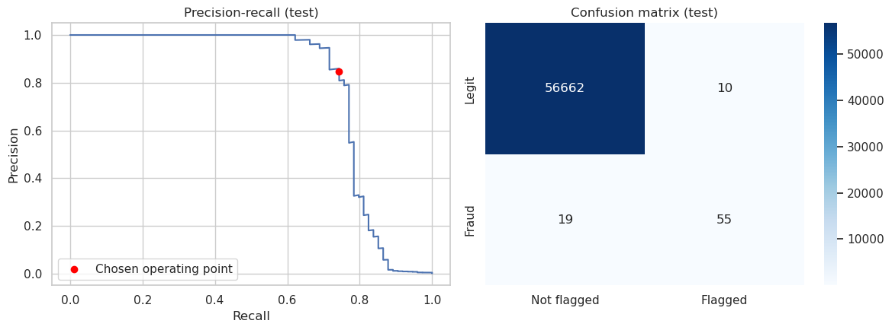

# Fraud Detection in Online Card Transactions

> Flagging fraudulent card transactions and choosing *how many alerts to raise* so that a fraud team saves more than it spends. Built with scikit-learn, with a time-based evaluation.

**Dataset:** Credit Card Fraud Detection (ULB / Worldline): 284,807 European card transactions over two days, 0.173% fraud · **Tools:** Python, pandas, scikit-learn, matplotlib, seaborn

## Business Problem
A payment provider loses money on every undetected fraud, but each alert also costs analyst time and may annoy a legitimate customer. A model that "is 99.8% accurate" is worthless here, since predicting "legit" for everything already scores that. The real question is: **which transactions should be reviewed, and how many, to maximize net savings?**

## Approach
1. **Data validation:** missing values, exact duplicate rows (dropped to avoid train/test contamination), class imbalance.
2. **EDA:** amount distribution by class, fraud rate over time, features that separate fraud most.
3. **Time-based split:** 60% train / 20% validation / 20% test in chronological order, so the model never learns from the future.
4. **Three model families:** logistic regression (supervised baseline), Isolation Forest (unsupervised anomaly detection, no labels), and tuned gradient boosting using `TimeSeriesSplit` cross-validation.
5. **Metric:** PR-AUC (average precision) instead of accuracy or ROC-AUC, plus a bootstrap interval because the test set has few frauds.
6. **Business-driven threshold:** choose the alert rate that maximizes `fraud amount caught - review cost x alerts` on the validation set.
7. **One-shot test evaluation:** precision, recall, money caught, confusion matrix, and an alert-budget table (precision/recall if analysts can review only 0.05% to 1% of transactions).

## Key Decisions
| Issue | Decision |
|---|---|
| Extreme imbalance (0.173% fraud) | PR-AUC as the main metric; accuracy only shown to explain why it is misleading |
| Shuffled splits would leak the future | Chronological train/validation/test split and `TimeSeriesSplit` for tuning |
| Duplicate rows | Dropped before splitting (1,081 exact duplicates found) |
| Few frauds in the test set | Bootstrap confidence interval on PR-AUC |
| Probabilities are extremely skewed | Threshold searched over alert-rate quantiles, not a fixed 0.1-0.9 grid |
| Complex vs. simple model | Gradient boosting kept only if it clearly beats logistic regression |
| Labels are not always available | Isolation Forest included as an unsupervised reference |

## Project Structure
```
notebooks/fraud_detection.ipynb   -- full analysis, from validation to model saving
data/                             -- place creditcard.csv here (not committed)
models/                           -- saved model + threshold (generated)
images/                           -- charts for this README
requirements.txt
```

## How to Run
```bash
git clone https://github.com/andikapratamazaid/fraud-detection-card-transactions.git
cd fraud-detection-card-transactions
pip install -r requirements.txt
# download the dataset into data/ (see data/README.md)
jupyter notebook notebooks/fraud_detection.ipynb
```

## Results
All numbers below are the actual output of the executed notebook in this repo. After dropping duplicates: train 170,235 transactions (342 frauds), validation 56,745 (57 frauds), test 56,746 (74 frauds).

| Model | Validation PR-AUC | Test PR-AUC |
|---|---|---|
| Logistic regression | 0.760 | 0.746 |
| Isolation Forest (unsupervised) | 0.020 | 0.036 |
| Gradient boosting (tuned) | 0.783 | 0.785 |

- **No-skill PR-AUC** (= fraud rate): 0.0010 on validation, 0.0013 on test. The tuned model scores roughly 600x that on the test set; gradient boosting is kept because it beats logistic regression on both validation (0.783 vs. 0.760) and test (0.785 vs. 0.746).
- **Test PR-AUC 95% interval:** [0.693, 0.892] (bootstrap; the interval is wide because the test slice holds only 74 frauds).
- **Chosen alert rate:** 0.089% of transactions (threshold 0.6338, picked on validation) → on the test set that is 65 alerts (0.115%), with **precision 0.846** and **recall 0.743**.
- **Fraud amount caught:** **65.8%** of total fraud value (5,089 of 7,728), **net savings 4,764** on the test set at `REVIEW_COST` = 5 per review. On validation the same rule nets 7,501, while flagging everything would lose 271,494.
- **Alert-budget view (test):** reviewing just the top 0.05% of scored transactions is 100% precise and already catches 37.8% of frauds; at a 0.10% budget, precision is 0.946 with recall 0.716. Precision collapses beyond that (0.216 at 0.50%), so a small, fixed review budget is the sweet spot.
- **Isolation Forest is far weaker** (test PR-AUC 0.036) but needs no labels at all, so it remains a fallback reference for settings without fraud history.



## Business Recommendations
| Finding | Action |
|---|---|
| A tiny alert budget already captures most of the value: the top 0.10% of scores catch 71.6% of frauds at 94.6% precision | Start with a fixed daily review budget around the chosen alert rate (~0.1%) and tune from there |
| Fraud amounts are usually small (median 9.82 vs. 22.00 for legitimate transactions) and low budgets stay precise | Consider auto-approving very small transactions to save review capacity for larger ones |
| Fraud concentrates in the small hours, where the fraud rate reaches ~1.5% of transactions vs. near zero at midday | Weight staffing and review SLAs toward night hours instead of spreading them evenly |
| Unsupervised scores are weaker but need no labels (test PR-AUC 0.036 vs. 0.785) | Use Isolation Forest only as a fallback for new merchants or markets with no fraud history |

## Limitations
- Only two days of European card data from 2013, so no seasonality or long-term drift testing, and not representative of Indonesian payment behavior.
- Few frauds in the test slice, so metrics are noisy.
- Anonymized PCA features limit interpretability and prevent merchant, device or customer-history features.
- In production, fraud labels arrive late (chargebacks), and fraudsters adapt over time.
- Cost assumptions are simplifications: fixed review cost, flagged fraud assumed fully prevented, no customer-friction cost for false alarms.

## Next Steps
- Repeat on the IEEE-CIS Fraud Detection dataset with richer features (device, email domain, transaction history)
- Velocity and behavioral features, SHAP explanations
- Probability calibration and a drift-monitoring plan
- Simple API or Streamlit demo that scores a transaction

## Related Projects
- [E-Commerce RFM Segmentation & Cohort Retention (SQL)](https://github.com/andikapratamazaid/ecommerce-rfm-cohort-sql)
- [Customer Churn Prediction for a Telecom Provider](https://github.com/andikapratamazaid/telco-churn-prediction)
- [Fraud Operations KPI Dashboard](https://github.com/andikapratamazaid/fraud-ops-kpi-dashboard) — monitoring dashboard built on this project's model

## Author
**Andika Pratama Zaid** · [LinkedIn](https://linkedin.com/in/andikapratamazaid) · [GitHub](https://github.com/andikapratamazaid)
